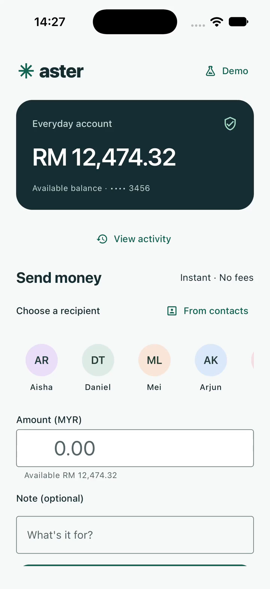

# Aster Transfer

A React Native + TypeScript payment-transfer assessment for Android and iOS. Aster is an independent demo brand; transfers use a local simulated bank and never move real money. Expo supplies the React Native framework and native build tooling. Authentication uses the operating system.

## Implemented features

- MYR transfer form with registered recipients, integer-sen validation, optional notes, available funds and editable review.
- Native biometric authorization for the reviewed payment, with OS device credentials as fallback. Devices without secure authentication must complete device setup before sending.
- Asynchronous processing, atomic SQLite debit/receipt, duplicate-request protection and persistent reconciliation when a response is lost.
- Native contacts picker with permission, limited/denied access, search, paging and registered-number resolution. Contact aliases never replace verified payee names.
- Paginated activity, detailed receipts and editable re-send requiring fresh authorization.
- Demo scenarios for success, network rejection, insufficient funds and response loss. All retain native authorization.

The confidential assessment PDF is excluded from Git. Both stretch goals are part of the delivery scope.

## Run locally

Use Node 24 from `.nvmrc`. Android needs Android Studio, the Android SDK and JDK 17; iOS needs macOS, Xcode with a Simulator runtime, and CocoaPods. A device/emulator must have a screen lock or enrolled biometrics to complete a transfer. Keep SDK-compatible dependency versions together. The repository uses the public npm registry; no private packages or registry credentials are required.

```sh
nvm install
nvm use
npm ci
npm run check

# macOS convenience environment; see script for overrides
source scripts/mobile-env.sh
npm run android

# Or, on macOS:
npm run ios
```

These commands build native development clients. Expo Go and web previews are not acceptance targets. No Expo cloud account is needed. Generated `android/` and `ios/` projects are ignored; change native configuration through `app.json` and config plugins. Do not commit SDK paths or signing credentials.

For a standalone local Release build (no Metro at launch):

```sh
npm run android -- --variant release
# macOS iOS Simulator:
npm run ios -- --configuration Release
```

The generated Android APK is under `android/app/build/outputs/apk/release/`. This assessment build uses the generated development signing certificate; production/store signing is separate. The iOS target above is a Simulator build, not a distributable signed IPA.

After the first build, `npm start` starts Metro. If 8081 is occupied, use `npm run android -- --port 8082` (or `ios`) and `npm start -- --port 8082`. On Xcode 27 the simulator UI is in Device Hub.

**Android Studio:** use a checkout path without spaces, such as `aster-transfer`. Expo Modules Core's IDE helper splits compiler paths on spaces. A separate clean, space-free checkout passed install, checks, native generation, the IDE helper, ARM64 Release build and Android Studio 2026.2.1 Gradle sync. Command-line builds also work in the original path.

## Walkthrough

1. Choose a saved recipient, enter an amount such as `12.34`, and optionally add a note. Review shows the registered name and account.
2. Choose **Authorize & send** and complete the native prompt. Cancellation never sends. The receipt shows amount, payee, reference, time and remaining funds.
3. Open **View activity**, select a receipt and choose **Send again**. Edit/review it and authorize again.
4. Open **Demo** before review to select a failure scenario. For **Response lost**, authorize once, then choose **Check transfer status**; it reads the existing reference instead of sending again. Restart also reconciles saved pending attempts.
5. Open the contacts picker to request native access. Use fictional test contacts; Aisha's registered fixture number is `+1 202-555-0101`. Unknown numbers cannot become bank recipients. Saved recipients work without contact access.

**[Watch the native demo (60 seconds)](docs/media/demo-ios.mp4)** — iOS Simulator Release: validation, limited contacts, review, OS Face ID, receipt, history, edited re-send and a fresh authorization cancelled after non-match. Static waiting intervals are shortened; the UI and OS prompts are actual recordings. Simulator biometric events do not prove a physical sensor.



The Android physical-device demonstration is pending. Installable binaries stay outside Git.

## Structure and decisions

See [design and challenges](docs/DESIGN.md) and [architecture and dependency rationale](docs/ARCHITECTURE.md). Each component owns `index.tsx`, `index.styles.ts`, and any private hooks/tests. React Native uses typed native style sheets rather than browser SCSS.

Forms use React Hook Form/Zod, asynchronous state uses TanStack Query, native controls use React Native Paper, and the local ledger uses Expo SQLite. Money is integer sen; a unique attempt reference and an exclusive transaction keep the debit and receipt together. No second global state framework is needed.

## Checks

```sh
npm run check       # TypeScript, zero-warning ESLint, Prettier, Jest
npm run graph:init  # once per checkout, if code navigation is wanted
npm run graph:sync
npx codegraph explore "TransferScreen useTransfer LedgerDatabase"
```

CI installs from the lockfile and runs `check`; the pre-commit hook does the same. An existing local CodeGraph index is refreshed after commits.

All 80 tests across 10 suites, TypeScript, zero-warning lint and formatting passed. Native iOS checks cover Face ID outcomes, bank/network rejection, lost-response lookup, restart recovery, editable re-send and limited/denied contacts. Android checks include native launch, form/keyboard/review and blocking send without a secure lock. The iOS confirmation page was manually checked at the largest system text size. Physical Android authorization and successful system-credential entry remain pending.

Expo Doctor passed all 20 checks. The dependency audit retains four unique upstream advisories; affected implementations were absent from the inspected Android Release and iOS export bundles. These remain open toolchain risks; no forced incompatible SDK downgrade was applied. An audit pass or emulator run is not a production security certification.

## Assumptions and production boundary

The fictional wallet starts with RM 12,500.00 on first initialization. Normal launches and schema initialization never reset funds. Recipient accounts and phone numbers are fixtures. Contacts remain on device; picker results are discarded after closing.

This assessment simulates an API and ledger locally. A local OS prompt and database do not authorize a real bank transfer. Production needs server-side session authorization, transaction-bound challenges, balances/idempotency and remote reconciliation. This repository has no real bank integration, production signing or store-release claim.
