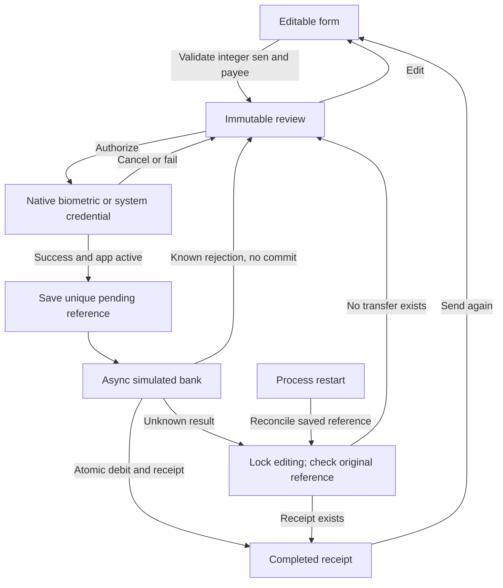

# Design and engineering decisions

Aster makes a small payment flow explicit: choose a registered payee, enter an exact MYR amount, review the account, authorize with the operating system, then receive a durable receipt. Independent branding, a clear balance card, restrained colors and visible confirmation keep attention on the payment details. This is a local simulated bank, clearly labelled throughout.

## State and trust boundaries

The repeat path returns to editing and requires new authorization. A status check reads the old reference and cannot send again. A real bank would own authorization, balances, idempotency and reconciliation on its server; local OS authentication alone is insufficient.

## Choices and tradeoffs

| Decision                                                | Why it helps this assessment                                                          | Boundary                                                                |
| ------------------------------------------------------- | ------------------------------------------------------------------------------------- | ----------------------------------------------------------------------- |
| React Native with Expo native builds                    | Native modules and reproducible configuration on Android/iOS; no hosted build account | Native builds are required; Expo Go/web are not acceptance evidence     |
| Feature folders with component-owned styles/hooks/tests | Clear ownership, readable render code and localized changes                           | Shared money/auth/ledger rules stay outside private component folders   |
| React Hook Form/Zod + TanStack Query                    | Separate editable fields from asynchronous account/history/mutation state             | No duplicate global store or automatic payment retries                  |
| Integer sen + exclusive SQLite transaction              | Exact arithmetic, conditional funds check and debit/receipt consistency               | Local mock service, not a remote banking ledger                         |
| Native OS credentials for fallback                      | No application PIN, biometric image or password storage                               | Physical device/successful credential entry must be verified separately |
| Contact numbers resolve to registered fixtures          | Contact aliases cannot impersonate a verified payee                                   | Contacts stay local; unknown numbers do not become bank accounts        |
| Cursor paging + virtualized rows                        | Bounded reads and stable pages while new activity arrives                             | Emulator frame samples are not physical-device performance guarantees   |

Use [ARCHITECTURE.md](ARCHITECTURE.md) for module and dependency conventions.

## Problems actually encountered

- A successful biometric result briefly preceded iOS returning to active state. A bounded foreground wait and scope checks fixed the no-send race without extending authorization across a background departure.
- Exact currency formatting initially used an Intl method unavailable in iOS Hermes. A native Release launch exposed the crash; a missing-method regression and exact digit-string formatter repaired it without a polyfill.
- The native limited-contacts presenter dismissed its enclosing React Native modal. System Settings management plus foreground refresh keeps the picker state consistent; native return and reopen were verified.
- Extreme text scaling exposed fixed-width headers/recipient cells and instructions outside the list scroll area. Reflow, full-value money fitting and scrollable list headers address those constraints.

- A foreground refresh started a native contact read before a changed permission check completed. A deferred-permission regression reproduced the extra read request; refresh now checks access first, and denied/error states hide contact rows and page-retry actions. The OS still enforces permission independently.
